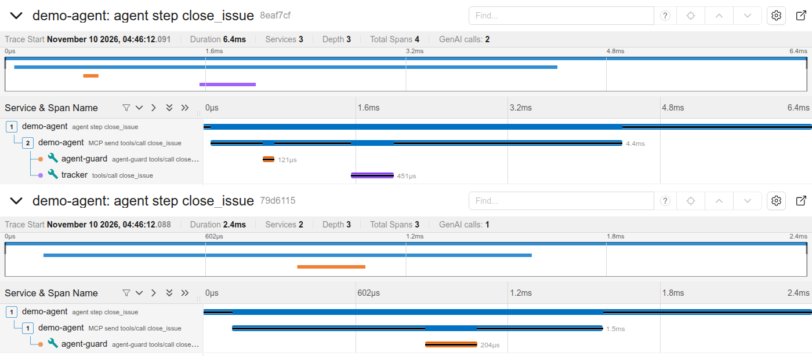

# agent-guard

AI agents call tools that change real things, and the only check between a bad idea and `delete_file` is the
model's own judgement. agent-guard puts rules you can read, review and test in front of those tools, and keeps a
tamper-evident record of every call.

It is a small proxy for [MCP](https://modelcontextprotocol.io) tool servers. For a local server, your client
starts agent-guard instead of the server; agent-guard starts the server and sits on the pipe between them. For a
remote one, `agent-guard serve` is a gateway on localhost in front of its URL (see
[Remote servers over HTTP](#remote-servers-over-http)).

```
agent (MCP client)  <--stdio-->  agent-guard run    <--stdio-->  MCP server (files, shell, database, ...)
agent (MCP client)  <--HTTP--->  agent-guard serve  <--HTTPS-->  remote MCP server
                                        |
                            guard.yaml      audit.jsonl
                            (rules)         (hash-chained)
```

- **Rules as code.** A YAML file says allow, deny or ask for each call, by tool name, argument patterns and rate.
  First match wins, like a firewall. Anything not listed is denied. Resource reads and prompt fetches can be
  judged the same way.
- **Blocked calls fail softly.** The agent gets a normal tool error with the reason, so it can change course.
  The server never sees the call.
- **Audit log you can check.** Every decision and result is one JSON line, hash-chained to the line before it.
  `agent-guard verify` finds the first edited, removed or reordered line, as long as the head hash is kept
  somewhere the agent cannot write (see Limits).
- **A mistake happens once.** `agent-guard learn` turns an incident from the log into a new rule plus a
  regression test. `agent-guard test` replays those tests in CI, so nobody can quietly loosen the policy later.
- **Tools that can never pass are hidden** from `tools/list`, so the agent does not waste turns on them.
- **Local and remote servers.** Over stdio, or as a gateway in front of a Streamable HTTP server, on both MCP wires
  (2025 sessions and 2026-07-28). Checked in CI with the official Python and TypeScript SDK clients and the
  official reference server, and by hand against a public server.
- **Decisions in your traces.** With an OTLP endpoint set, each decision is an OpenTelemetry span inside the
  agent's own trace, so a blocked call is visible where you already look ([screenshot](#traces)).

Stdlib Python plus PyYAML. No MCP SDK needed at runtime: MCP over stdio is newline-delimited JSON-RPC, and
agent-guard only steps in on `tools/call` (and resource reads and prompt fetches, if you turn those on), so it
works with any protocol version the two ends agree on. The HTTP gateway needs the `http` extra: Starlette, Uvicorn
with httptools, and HTTPX2, the HTTP stack the MCP SDK itself runs on.

## Try it in under a minute

```sh
git clone https://github.com/Ahmedabied/agent-guard && cd agent-guard
python3 -m venv .venv && . .venv/bin/activate && pip install -e .
python examples/demo.py
```

The demo runs a scripted agent against a tiny file server ([examples/files_server.py](examples/files_server.py))
through the example policy ([examples/guard.yaml](examples/guard.yaml)). Real output, trimmed:

```
1. An agent session through the guard
  ok      read_file(path='/tmp/agent-guard-demo/notes/plan.md')
  BLOCKED delete_file(path='/tmp/agent-guard-demo/notes/plan.md')
          -> agent-guard blocked this call to delete_file: notes are read-only for agents (rule: notes-are-read-only)
  BLOCKED delete_file(path='/tmp/agent-guard-demo/scratch/../notes/plan.md')
          -> agent-guard blocked this call to delete_file: notes are read-only for agents (rule: notes-are-read-only)
  ok      delete_file(path='/tmp/agent-guard-demo/scratch/report-final.pdf')

3. Deleting report-final.pdf was a mistake. Turn it into a rule:
  $ agent-guard learn --seq 9 --name keep-final-reports --match 'path=*final*' ...
  added rule 'keep-final-reports' at the top of guard.yaml

4. Same mistake, next session:
  BLOCKED delete_file(path='/tmp/agent-guard-demo/scratch/report-final-v2.pdf')
          -> agent-guard blocked this call to delete_file: final reports are kept (rule: keep-final-reports)
  $ agent-guard test
  8/8 cases pass
  ok: 11 entries, chain intact, head c7a5c6bd0548...
```

Note the second block: `scratch/../notes/plan.md` is judged as the path it really points to.

## Put it in front of a real server

Wherever your MCP client config names a stdio server, put `agent-guard run -p <policy> --` in front of it:

```json
{
  "mcpServers": {
    "files": {
      "command": "agent-guard",
      "args": ["run", "-p", "/path/to/guard.yaml", "--",
               "npx", "-y", "@modelcontextprotocol/server-filesystem", "/path/to/project"]
    }
  }
}
```

MCP clients often start servers with a short `PATH`. If `agent-guard` is not found, use the full path to it
(for example `/path/to/agent-guard/.venv/bin/agent-guard`), or let uv fetch it:
`"command": "uvx", "args": ["--from", "git+https://github.com/Ahmedabied/agent-guard", "agent-guard", "run", ...]`.

Checked with the official filesystem server (`@modelcontextprotocol/server-filesystem`) driven by the official
MCP Python SDK client: tools the policy never allows disappear from the list, a write into a read-only folder
comes back as a tool error, and a write elsewhere goes through.

## Remote servers over HTTP

A server with a URL (Streamable HTTP) gets a gateway instead of a wrapper. It listens on localhost, judges every
request with the same policy and audit log as `run`, and passes the rest to the server. To see it once, with a
pretend issue tracker as the server and an agent on the official MCP SDK:

```sh
pip install -e '.[http,sdk]' && python examples/http_demo.py
```

```
2. An agent session through the gateway
  connected to http://127.0.0.1:37733/mcp, protocol 2026-07-28
  tools: close_issue, list_issues  (delete_repo is hidden)
  ok      list_issues(repo='sandbox/demo')
  BLOCKED close_issue(repo='prod/api', number=12)
          -> agent-guard blocked this call to close_issue: issues in prod/ repositories are closed by people, not agents (rule: prod-is-hands-off)
  ok      close_issue(repo='sandbox/demo', number=15)
  BLOCKED delete_repo(repo='prod/api')
```

For a real server:

```sh
pip install 'agent-guard[http] @ git+https://github.com/Ahmedabied/agent-guard'   # or pip install -e '.[http]'
export MCP_TOKEN="Bearer ..."            # only if the server wants a key
agent-guard serve -p guard.yaml --upstream https://mcp.example.com/mcp \
    --upstream-header Authorization=MCP_TOKEN
# agent-guard: serving http://127.0.0.1:8808/mcp -> https://mcp.example.com/mcp
```

Install it from this repository: the name `agent-guard` on PyPI belongs to an unrelated project. Then point the
client at `http://127.0.0.1:8808/mcp` instead of the server's URL. It works with both wires the
official SDK speaks: the 2025 one (`initialize`, a session id, answers as JSON or an SSE stream, a GET stream for
server messages) and 2026-07-28 (one self-contained POST per request). A denied call is answered by the gateway
and never sent. Tools the policy never allows are hidden from `tools/list` in JSON and SSE answers alike.

A gateway is a new way in, so it refuses more than the stdio proxy has to:

| Refused | Why |
|---|---|
| Listening anywhere but loopback | it has no client authentication, so on a network anyone could use the server (and its key) through it |
| A `Host` other than its own loopback address, an `Origin` other than its own | DNS rebinding: a web page must not reach it through the browser |
| A body that is not `application/json`, is compressed, is over 4 MiB, is not strict JSON, or is a batch | what cannot be judged is not forwarded |
| `Mcp-Method`, `Mcp-Name` or `MCP-Protocol-Version` that disagree with the body, or appear twice | a server routing on the header while the guard judged the body would run a call nobody judged |
| A redirect from the server | not followed: the request goes where you pointed it, nowhere else |
| Plain `http://` to anything but loopback, a user or password in the URL | use `https` and `--upstream-header` |

What the server receives is built by the gateway: the body is re-serialised from the parse the policy judged, and
only MCP's own headers are copied (`Accept`, `Mcp-Session-Id`, `MCP-Protocol-Version`, `Mcp-Method`, `Mcp-Name`,
`Last-Event-ID`). `Mcp-Param-*` headers (2026-07-28: tool arguments the schema marks with `x-mcp-header`, mirrored
so a load balancer can route on them) are never copied from the client. The gateway learns each tool's schema from
the `tools/list` answers it passes on (or, for an allowed call to a tool it has not met, asks the server itself
under its own name) and writes the
headers from the judged arguments, with the same rules as the official SDK (checked against its own functions in
the tests). So whatever routes on `Mcp-Param-Region` sees the region the policy saw, and a forged one is replaced. The client's `Authorization` and cookies are never forwarded; the server's key
comes from `--upstream-header NAME=ENVVAR`, read from the environment so it is not on the command line, and no
header value is ever written to the audit log. Each of these refusals has a test that sends the request and then
checks the server never saw it.

The flows around a call work too, each with a test on both wires: progress notifications arrive while the tool
runs (the gateway streams, it does not buffer); a server can ask the client something mid-call (elicitation:
on 2025 the question rides the call's stream and the answer is a new POST; on 2026-07-28 the call ends
`input_required` and the client sends it again with the answer, and the guard judges, logs and rate-counts that
second call like any other, because it carries new content); a client that gives up cancels the call upstream
too (2026-07-28 cancels by closing the request, so the gateway closes its own); and a call approved by `ask` after
its client has left is not sent.

Long sessions are fine: each 2025 session keeps a stream open for server messages, and with 600 of them open
through one gateway a call still answered in 3 ms; when their clients went away, every upstream connection closed
with them (file descriptors back to the baseline). 150 SDK sessions in a row leave nothing behind.

CI runs the official TypeScript SDK clients through the gateway too, v1 (`@modelcontextprotocol/sdk` 1.32) and v2
(`@modelcontextprotocol/client` 2.4) in both handshakes, against a server answering with SSE and with JSON: the
same hidden tool, allowed read and two blocked calls, plus a 2026-07-28 call whose `Mcp-Param` headers the server
checks (`tests/test_ts_clients.py`).

Checked against a real remote server, DeepWiki's public one (`https://mcp.deepwiki.com/mcp`, no key), with the
official MCP Python SDK client in both handshakes and a policy that denies `ask_question`: the tool disappears
from the list, a call to it is answered by the gateway, `read_wiki_structure` goes through (0.4 to 0.5 s, the
server's own time), and `agent-guard verify` reads the log as intact.

## The policy

```yaml
version: 1
default: deny              # what happens when no rule matches
hide_denied_tools: true    # drop tools that can never pass from tools/list
guard_resources: true      # judge resources/read too (off by default, see below)
guard_prompts: true        # and prompts/get (off by default)
ask: {via: tty, timeout: 60}
audit: {path: audit.jsonl}

rules:
  - name: notes-are-read-only
    tool: [write_file, delete_file]          # glob, or a list of globs
    args:
      path: {under: /data/notes}             # normalised, so ../ tricks do not work
    decision: deny
    reason: notes are read-only for agents   # the agent sees this

  - name: write-burst
    tool: write_file
    rate: 20/minute                          # matches only once the limit is used up
    decision: deny

  - name: no-rm-rf
    tool: run_shell
    args:
      "*": {regex: 'rm\s+-\w*(r\w*f|f\w*r)'} # "*" means any value anywhere in the arguments
    decision: deny

  - name: file-work
    tool: [read_file, write_file, delete_file, run_shell]
    decision: allow
```

| Operator | Meaning |
|---|---|
| `"text*"` (a plain string) or `glob:` | glob match, `*` matches any characters including `/` |
| `regex:` | Python regex, searched anywhere in the value |
| `under:` | the path, after normalising `.`, `..` and `//`, is inside one of these folders. A value that is not an absolute path (`notes/a.md`, `~/a.md`, `file://...`) cannot be placed, so it matches deny and ask rules and never satisfies allow rules |
| `equals:` | exact value; `true` does not equal `1` |
| `contains:` | substring of a string, or item of a list. In deny and ask rules it also finds the text inside any string in a list or object (`["bash", "-c", "rm -rf /"]`) |
| `not_glob:` `not_regex:` `not_under:` | the opposite |

Arguments are named by key, or by a dotted path into nested objects (`options.force`, `files.0`). The matching
rules are written to fail closed:

- An argument that is missing makes a `not_*` deny rule match, and never satisfies an allow rule.
- A list or object where a string was expected is checked value by value: one bad value is enough for a deny
  rule, every value must pass for an allow rule.
- A dotted key is checked both as a nested path and as a literal key with dots in it.
- Duplicate JSON keys, `NaN` and invalid UTF-8 are refused before any rule runs, and the server receives the
  message exactly as it was judged. Two JSON parsers that disagree on `{"name": "read_file", "name": "delete_file"}`
  would otherwise let one call through as another.
- Typos in the policy (`decison: deny`, an unknown operator, a bad regex) stop it from loading, with the rule name.
- So does a key written twice in one mapping, such as a second `rules:`. Plain YAML keeps the last one and silently
  drops every rule above it.

**Resources.** An MCP server can expose files as resources, and a client reads them with `resources/read`, not a
tool call, so a rule on `read_file` does not cover them. With `guard_resources: true` every read is judged like a
call to a tool named `resources/read` with the arguments `uri`, `scheme`, `host` and `path`, once for every reading
a server might take: the read is denied if any reading is denied and allowed only if all are. For a local `file://`
uri, `path` is the decoded path, so `under:` sees through `..` and `%2e%2e`. For any other scheme, `path` is the
decoded path, the decoded host and path together, and the raw uri; the raw uri cannot be placed in a folder, so
`under:` deny rules always catch another scheme and `under:` allow rules never pass one: allow those by `scheme` or
`uri` (rules on `uri` see it as sent, percent-encoding included). `host` is the host as written and lowercased
without user or port. Refused before any rule: a uri that does not parse or has no scheme, and a `file://` uri
naming another host, port or user (servers tend to read the path and ignore the host, so a rule would judge a
different file). A blocked read is answered with a JSON-RPC error. It is off by default only so an existing policy
does not start refusing reads: with `default: deny`, turning it on refuses every read until a rule allows it, for
example:

```yaml
  - {name: read-notes, tool: "resources/read", args: {scheme: file, path: {under: /data/notes}}, decision: allow}
```

**Prompts.** A client fetching a prompt with `prompts/get` sends the server the prompt's name and its arguments,
and gets back text that goes straight into the model's context. With `guard_prompts: true` every fetch is judged
like a call to a tool named `prompts/get` with the arguments `name` (the prompt) and `arguments` (what the client
filled in), so a rule can allow some prompts or deny one by an argument:

```yaml
  - {name: no-env-prompt, tool: "prompts/get", args: {name: dump_env}, decision: deny}
  - {name: review-only-src, tool: "prompts/get", args: {name: review, arguments.path: {under: /src}}, decision: allow}
```

The prompt's arguments stay under `arguments`, so an argument called `name` cannot pass for the prompt's name, and
the audit log scrubs secrets there as it does for tool arguments. A blocked fetch is answered with a JSON-RPC
error, as a missing prompt would be. A `tools/call` to a tool named `prompts/get` or `resources/read` is refused
(rule `reserved`) whatever the policy says: rules on those names are written for those requests and must not judge
a tool that took the name.

CI runs the official reference server, `@modelcontextprotocol/server-everything` 2.2.1, behind the guard on stdio and
over HTTP with the Python SDK client: `get-env` (it prints the server's environment) is hidden and refused,
`echo` passes, and `args-prompt` is allowed for one state and blocked for another by a rule on `arguments.state`.

`ask` sends the call to a person: `via: tty` asks on the terminal agent-guard was started from, `via: command`
runs a command with the call as JSON on stdin (exit 0 approves), `via: deny` refuses. With nobody to ask, the
answer is no.

## The audit log

One JSON object per line. `prev` is the hash of the line before, `hash` is sha256 of the line's own canonical
JSON. Arguments are logged with secrets removed: keys like `password`, `token` or `api_key` (in any casing), and
values that look like keys (Bearer tokens, PEM private keys, common token formats). Long values are shortened to
a length and a hash.

```sh
agent-guard log audit.jsonl --denied     # recent entries with their seq numbers
agent-guard verify audit.jsonl           # ok: 11 entries, chain intact, head c7a5c6bd...
agent-guard verify audit.jsonl --expect-head c7a5c6bd...   # also catches lines cut from the end
```

If the log cannot be written (disk full), calls are denied. No record, no tool call.

## Traces

Set the usual OpenTelemetry variable and every decision becomes a span in your tracing backend (install the
`otel` extra: `pip install -e '.[otel]'`):

```sh
export OTEL_EXPORTER_OTLP_ENDPOINT=http://localhost:4318   # Jaeger, Tempo, an OTel collector, ...
agent-guard serve -p guard.yaml --upstream https://mcp.example.com/mcp
```

The span is `agent-guard tools/call <tool>` with `agent_guard.decision`, `agent_guard.rule` and, for a block, the
policy's reason. Its parent is the trace the client sends in the request's `_meta` (MCP's W3C `traceparent`, which
the official SDKs fill in), so the guard shows up inside the agent's own trace: an allowed call has the guard's
span next to the server's, a blocked one has the guard's span and nothing from the server. The HTTP demo, traced
and opened in Jaeger 2.23 (top: sandbox issue closed; bottom: the prod/ one, blocked):



CI does the same against a real Jaeger and reads the traces back from its API
(`OTEL_EXPORTER_OTLP_ENDPOINT=http://localhost:4318 python examples/http_demo.py`, then
`python examples/jaeger_check.py`); a unit test checks it against a stand-in collector too. Spans never carry
arguments or resource uris, which can hold anything; the audit log, with its scrubber, keeps those. Tracing
cannot change or fail a decision: a span is written after the decision, any error in it is dropped, and with the
collector down calls run as before. It costs about 15 us per call (stdio bench: 99 to 105 us added with tracing
on, 83 to 116 us off).

## From incident to rule

```sh
agent-guard log audit.jsonl                                # find the call that went wrong
agent-guard learn -p guard.yaml --seq 9 --name keep-final-reports \
    --reason "final reports are kept" --match 'path=*final*'
agent-guard test -p guard.yaml guard-tests.yaml            # add this to CI
```

`learn` puts the rule at the top of the policy (first match wins, so it beats any broader allow), keeps your
comments and layout, refuses to write a rule that would not have caught the incident, and appends a regression
case to `guard-tests.yaml`. It edits the text and then checks the parsed result: the new policy must be the old
one with exactly one rule added in front, or nothing is written. An inline list (`rules: [...]`) is refused with a
request to write it as a block list. Without `--match` it matches the exact values from the incident.

`agent-guard check -p guard.yaml delete_file '{"path": "/data/notes/a.md"}'` shows the decision for one call
without running anything (exit code 0 allow, 1 deny, 3 ask).

## How fast

`python bench/bench.py --calls 3000` times sequential `tools/call` round trips against the demo server, once
directly and once through agent-guard with the example policy and a real audit log:

| | median | p99 |
|---|---|---|
| added per tool call, audit fsync off (default) | 89 to 126 us | about 210 us |
| policy check alone | 3.6 us | |
| added per tool call, audit fsync on (ext4) | 714 us | 15 ms |

Five runs on an Intel i5-14400F, Python 3.12, with the machine busy (load 3.4). Most of the added time is the two
extra pipe hops and thread wake-ups, not the checks: the policy is 3.6 us and the audit write about 12 us.
Over HTTP (`python bench/bench_http.py --calls 2000`, the SDK demo server on 2026-07-28 with JSON answers), the
gateway adds about 0.75 ms per call: 0.74 to 0.79 ms (median) over five runs on Python 3.13, next to 0.61 to
0.62 ms for the server's own round trip. About 60 us of that is watching each request for its client leaving,
so a cancel reaches the server (added in 0.3.1; before it, 0.68 to 0.72 ms). That is one more HTTP server and client hop on loopback; against a remote server it is small next to
the network.

Every call is written to the log before it is forwarded. With fsync off, a crash of agent-guard itself can lose
at most the result lines of calls still in flight; a power cut can lose the last entries. Turn on
`audit: {fsync: true}` if that matters more than 0.7 ms per call.

## Limits

- **HTTP: no OAuth through the gateway yet.** A client that discovers OAuth from the URL it is given would ask
  the gateway, which does not answer it. Servers with no auth or a fixed key (`--upstream-header`) work. The
  gateway also has no login of its own, which is why it only listens on loopback.
- **HTTP: `Mcp-Param-*` for a tool the server does not list** cannot be built, so a call that carries them is
  refused (a call without them goes on, and a 2026-07-28 server refuses it if the tool needs them).
- **HTTP: one message per POST.** JSON-RPC batches are refused (the 2025-06-18 revision removed them).
- **`tools/call` is judged, `resources/read` with `guard_resources: true` and `prompts/get` with
  `guard_prompts: true`.** Without them, reads and prompt fetches pass through untouched. `prompts/list` is not
  filtered (`hide_denied_tools` hides tools only), `completion/complete` (argument suggestions, which also send
  typed values to the server) is not judged, and requests from the server, such as sampling, always pass.
- **Patterns, not a sandbox.** A rule on a shell command string is a speed bump: a determined agent can phrase
  `rm` in ways a regex will not catch. `under` is lexical and does not follow symlinks, because the guard may not
  share a filesystem with the server. Pair agent-guard with server-side limits (allowed folders, read-only users,
  containers) and use it for policy, approval and the record.
- **Rate limits live in memory**, per agent-guard process. Restarting resets them. Behind `serve` that means one
  count, and one audit log, for every client and session the gateway serves.
- **The audit chain has no key.** Anyone who can write the file can rewrite it and recompute every hash, and
  `verify` will say ok. Deleting the file or cutting lines from the end is the same. The chain catches accidents
  and careless edits; against a writer who means it, keep the head hash (`--expect-head`) on another machine.
- **A message the guard fails to judge is denied**, answered with an error and logged, and the guard keeps
  serving. It then exits with code 70 so the failure is not silent. The error carries the request's own id even
  when the JSON parser gives up (nesting past about 1,000 levels on Python 3.10, 100,000 on 3.12 and later): the
  id is read from the raw text without recursion, so the client gets the same answer on every Python instead of
  waiting. Only when no single top-level id can be read is the id null.
- **Old-style JSON-RPC batches** (2025-03-26) are split: denied calls in a batch are answered one by one.
- File locking for several writers on one log is Unix only.

## Development

```sh
pip install -e '.[test,sdk,http,otel]'
pytest -q                      # 205 tests (10 need node)
```

The tests start real processes on real pipes. One suite drives agent-guard with the official MCP Python SDK on
both sides, in both handshakes: `initialize` (2025 protocol versions) and `server/discover` (2026-07-28, where
every result must carry `resultType`), over stdio and through the HTTP gateway (SSE and JSON answers); a CI job
does the same with the TypeScript SDK clients (`npm install --prefix tests/ts` to run it here). CI runs the tests, the example policy's regression cases and a short
benchmark on Python 3.10, 3.12 and 3.13.

Built with AI pair programming.

## Licence

MIT
